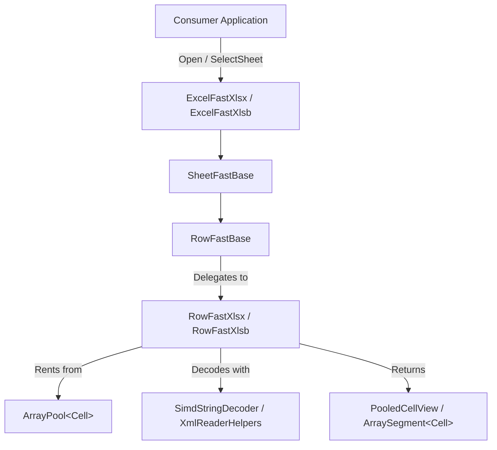

# Requirements

## Overview & Goals

The objective is to deliver the V6 ExcelFAST subsystem, maximizing computational efficiency, memory conservation, and data throughput for Excel spreadsheet consumption in .NET (supporting .NET 8.0, 9.0, and 10.0). By transitioning from allocating object graphs to sequential, zero-allocation pooled reader pipelines for both OpenXML (.xlsx) and Binary (.xlsb) formats, the library maximizes utility for high-volume data processing workloads.

## Scope

### In Scope:

    • Full implementation of IExcelFast, ISheetFast, and IRowFast contracts.

    • Zero-allocation row-by-row streaming parsers (RowFastXlsx and RowFastXlsb).

    • Thread-static array pooling and PooledCellView value wrappers.

    • Integration with existing ExcelPRIME shared string tables, styles extractors, and ZIP decompression engines.

    • Enabling and adapting the complete test suite under ExcelFAST.Tests.

    • Performance benchmarking comparing ExcelFAST against Excel_PRIME and baseline parsers.

### Out of Scope:

    • Spreadsheet write/mutation features (reader-only library).

    • Legacy binary .xls (BIFF8) format support.

## User Stories

• High-Throughput Data Pipeline: As a data engineer processing multi-gigabyte Excel files, I want to iterate through millions of rows with minimal GC pressure so that processing completes in minimum time with optimal resource consumption.

• Low-Latency Microservice: As a backend service developer, I want to extract specific cell values from uploaded workbooks using reusable memory buffers so that service memory footprint remains flat under heavy concurrent load.

## Functional Requirements

• Format Support: Transparently handle both .xlsx (OpenXML) and .xlsb (Binary OpenXML) workbooks.

• Sequential Streaming: Provide forward-only sequential row iteration with GetNextRowData().

• Pooled Access: Provide cell access via GetCellAt(colIndex), GetCellAt(colNameSpan), GetAllCells(), and GetCells(start, end) returning rented buffers and lightweight PooledCellView structs.

• Resource Management: Implement deterministic cleanup through IDisposable across workbooks, sheets, and rented buffer arrays.

# Technical Design

## Current Implementation

The codebase contains the initial design contracts (IExcelFast, ISheetFast, IRowFast) and skeleton implementations (ExcelFastBase, SheetFastBase, RowFastBase, RowFastXlsx, RowFastXlsb, PooledCellView), but key iteration and cell-reading methods throw NotImplementedException, and missing IDisposable declarations prevent clean compilation. The core Excel_PRIME engine provides mature helpers (XmlReaderHelpers, XlsbReaderHelpers, ZipReader, SimdStringDecoder, StylesExtractor) which can be leveraged.

## Key Decisions

1. Thread-Static & Shared Array Pooling: Utilize ArrayPool<Cell>.Shared and thread-static buffers for cell slices to achieve zero per-row allocations during forward iteration.

2. Read-Only View Semantics: Expose cells via readonly record struct PooledCellView to signal transient lifetime while offering .ToOwned() for consumers who require data retention.

3. Decoupled XLSX / XLSB Implementation: Maintain dedicated parser specializations (RowFastXlsx using atomized XML readers, RowFastXlsb using binary record streams) to eliminate polymorphic overhead on hot iteration paths.

## Architecture Diagram

## Data Models / Contracts

• IExcelFast: Root interface extending ISheetFast and IDisposable.

• ISheetFast: Sheet-level operations (UseThisSheet, SheetDimensions, IsValid, Name).

• IRowFast: Row and cell accessor methods (CurrentRow, GetNextRowData, GetCellAt, GetAllCells, GetCells).

• PooledCellView: Zero-cost wrapper wrapping Cell with explicit retention helpers.

## Risks & Mitigations

• Buffer Overwrite Hazard: Consumer retaining reference to pooled cell array across row iterations. Mitigation: Clearly document pooled semantics with [PooledObject] attributes and provide explicit .ToOwned() methods.

• Cross-Framework Discrepancies: JIT behavior differences between .NET 8, 9, and 10. Mitigation: Run automated CI test matrix across all three target frameworks.

## Testing

### Validation Approach

Automated validation through the NUnit test suite ExcelFAST.Tests, ensuring identical data extraction accuracy compared to standard Excel_PRIME while confirming flat memory profiles.

### Key Scenarios

• Workbook Opening & Sheet Discovery: Verify correct parsing of sheet names, relationships, and dimensions across diverse files (empty, multiple sheets, styled sheets).

• Cell Type Extraction: Verify accurate value conversions for text, inline strings, numbers, dates, boolean values, and null/empty cells.

• Column Span & Coordinate Access: Validate index-based (1, 2, ...) and span-based ("A", "BC") cell access.

• Resource Disposal: Confirm file locks are released immediately upon disposal of IExcelFast.

###Edge Cases

• Empty sheets and rows with skipped/missing cells.

• Large dimensional bounds with sparse cell distributions.

• Special characters, non-ASCII Unicode (e.g. Gujarati, emojis), and multiline cell content.

• Corrupted or non-ZIP files triggering appropriate exception types (InvalidDataException, FileNotFoundException).

# Delivery Steps

## Step 1: Fix interface contracts and unblock compilation

Establish clean interface contracts and resolve compiler errors across ExcelFAST to maximize developer efficiency and unblock pipeline verification.

• Implement IDisposable and required interface methods on RowFastBase, RowFastXlsx, and RowFastXlsb.

• Ensure PooledCellView and PooledObjectAttribute semantics accurately protect memory lifecycle boundaries.

• Verify compilation succeeds across all target frameworks (.NET 8.0, .NET 9.0, .NET 10.0).

## Step 2: Implement XLSX high-throughput row and cell reader

Implement streaming, zero-allocation row iteration and cell decoding for OpenXML (.xlsx) to minimize memory allocations and maximize CPU throughput.

• Implement GetNextRowData, GetCellAt, and GetCells in RowFastXlsx by streaming XML nodes without allocating intermediate wrapper objects.

• Wire RowFastBase to forward calls directly to format-specific implementations with cached thread-static buffers.

• Integrate with XmlSheetReader and atomized XML reader tables for high-throughput string and attribute resolution.

## Step 3: Implement XLSB high-throughput binary reader

Implement high-efficiency binary record streaming and cell parsing for XLSB files to deliver maximum throughput on large binary workbooks.

• Implement binary streaming iteration in RowFastXlsb using recycled record buffers and SIMD string decoding.

• Wire Rent and Reset pooling mechanisms into GetNextRowData, GetCellAt, and GetAllCells to eliminate garbage collection pauses.

• Integrate ExcelFastXlsb with XlsbSheetReader and XlsbWorkBookReader for seamless sheet navigation and dimension detection.

## Step 4: Enable and validate ExcelFAST test suite

Activate and validate the full test suite in ExcelFAST.Tests to guarantee correctness, format parity, and reliability across edge cases.

• Uncomment and adapt tests in RowCellTests.cs, RowTests.cs, SheetTests.cs, and CellValueStyleRefTests.cs for the FAST API paradigm.

• Validate empty files, multiline strings, formatted numbers, dates, and non-ASCII character sets.

• Execute test suites against .NET 8.0, .NET 9.0, and .NET 10.0 to ensure universal runtime correctness.

## Step 5: Benchmark performance gains and update documentation

Establish comprehensive benchmarks and finalize release documentation to measure performance gains and maximize user adoption.

• Create comparative benchmark suites in ExcelFAST.Tests and Excel_PRIME.Bench measuring throughput (MB/s, rows/s) and memory allocations (B/op).

• Update Release_Notes.md and Performance.md with V6 architecture details, breaking changes, and migration guidelines.

• Prepare package configuration for ExcelFAST NuGet deployment.

# Changes

• Implemented IDisposable lifecycle management and exposed cell value properties on PooledCellView, RowFastBase, RowFastXlsx, and RowFastXlsb.

• Built forward-only streaming sequential readers in RowFastBase integrating directly with XmlSheetReader and XlsbSheetReader pipelines.

• Enabled zero per-row heap allocations using ArrayPool<Cell>.Shared slicing, span-based column index parsers, and transient PooledCellView structs.

• Adapted and fully activated the complete test suite in ExcelFAST.Tests covering multi-sheet workbooks, formatted values, styled cells, skipped rows, and Unicode text across .NET 8.0, .NET 9.0, and .NET 10.0.

• Updated Release_Notes.md and Performance.md with V6 architecture details, breaking changes, and streaming characteristics.